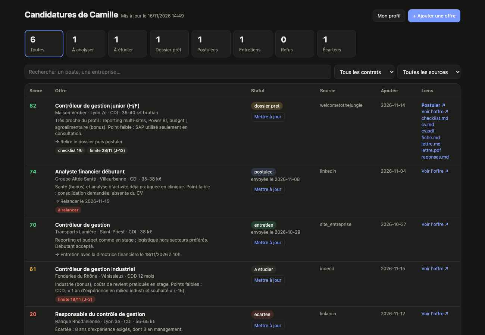
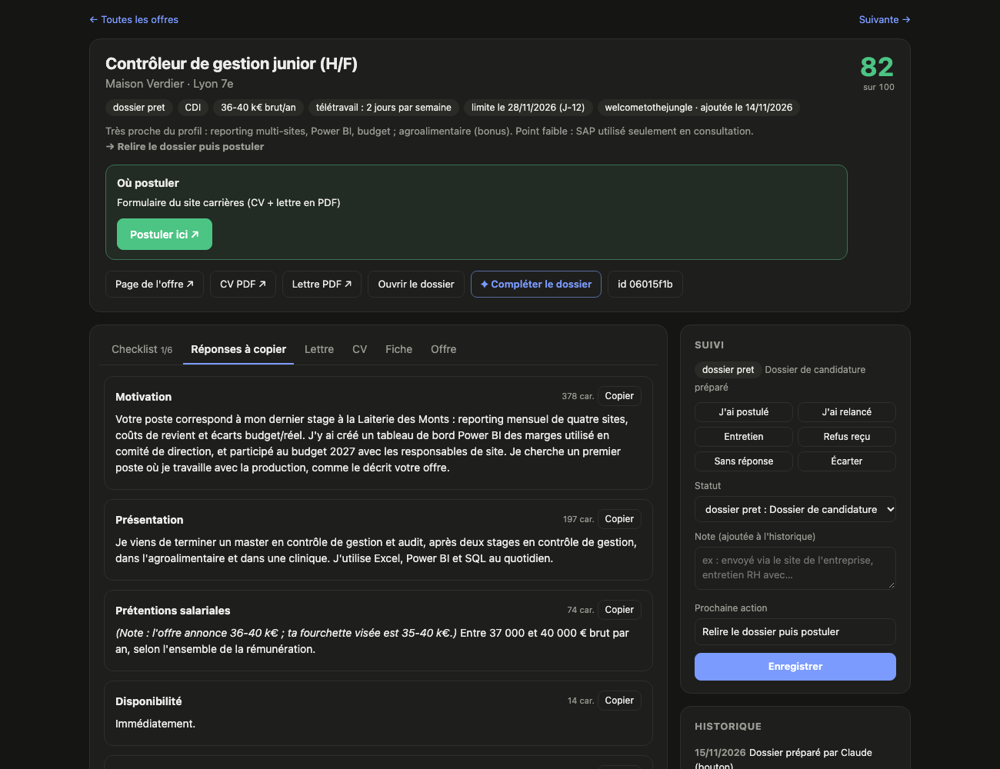
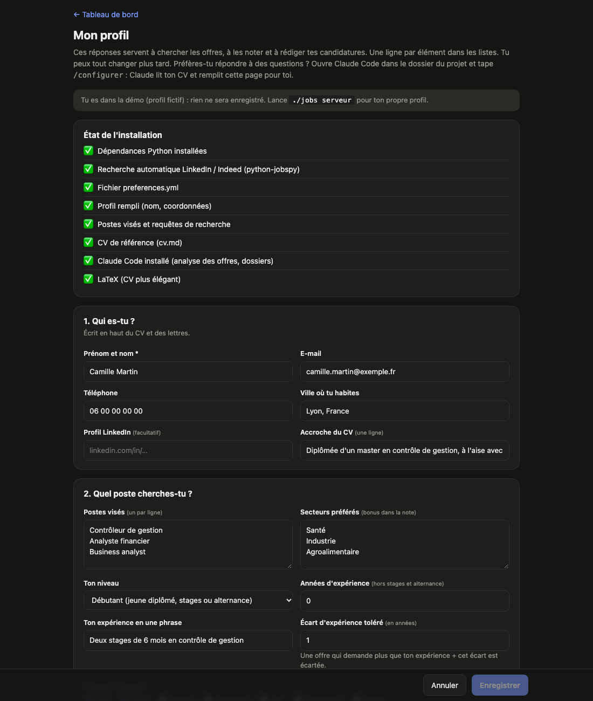
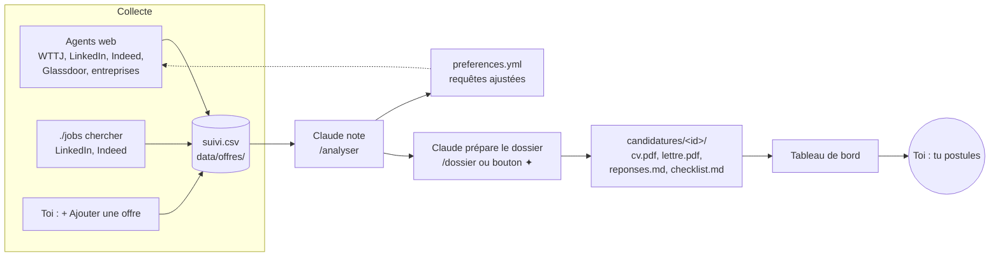

# claude-jobs

**Ton assistant de recherche d'emploi, propulsé par [Claude Code](https://claude.com/claude-code).**
Il cherche les offres qui correspondent à ton CV, les note, prépare un dossier de candidature complet pour chacune
(CV adapté, lettre, réponses aux formulaires, checklist) et suit tes candidatures dans un tableau de bord.
**Tu gardes la main :** rien n'est jamais envoyé à ta place, et rien n'est inventé dans tes candidatures.



---

## Sommaire
- [Ce que ça fait](#ce-que-ça-fait)
- [Ce qu'il te faut](#ce-quil-te-faut)
- [Installation (5 minutes)](#installation-5-minutes)
- [Essayer la démo](#essayer-la-démo)
- [Utilisation au quotidien](#utilisation-au-quotidien)
- [Comment ça marche](#comment-ça-marche)
- [Personnaliser](#personnaliser)
- [Vie privée et respect des sites](#vie-privée-et-respect-des-sites)
- [Dépannage](#dépannage)

---

## Ce que ça fait

| Étape | Qui le fait | Comment |
|---|---|---|
| 🔎 **Trouver** des offres | Claude + scripts | Welcome to the Jungle, LinkedIn, Indeed, Glassdoor, sites carrières des entreprises que tu vises |
| 📊 **Noter** chaque offre sur 100 | Claude | Adéquation avec ton CV, niveau d'expérience, secteur, contrat, lieu, salaire. Écarte les offres hors critères. |
| 📝 **Préparer** le dossier | Claude | CV adapté (PDF, 1 page), lettre de motivation (PDF), réponses prêtes à copier, checklist, questions d'entretien |
| ✅ **Postuler** | **Toi** | Tu relis, tu cliques sur « Postuler ici », tu coches la checklist |
| 📅 **Suivre** | Tableau de bord | Statuts, dates limites, relances à J+7, historique |

Et après chaque recherche, **Claude améliore lui-même les requêtes** d'après ce qui est ressorti (trop de postes seniors,
titres hors sujet…). Tu n'as rien à régler.

<details>
<summary>Voir la page d'une offre et la page « Mon profil »</summary>



</details>

---

## Ce qu'il te faut

- **macOS ou Linux** (sous Windows : passe par [WSL](https://learn.microsoft.com/fr-fr/windows/wsl/install)).
- **Python 3.9 ou plus récent** : tape `python3 --version` dans un terminal pour vérifier.
  Sinon : [python.org](https://www.python.org/downloads/) ou `brew install python`.
- **[Claude Code](https://claude.com/claude-code)**, avec un abonnement Claude (Pro ou Max) ou une clé d'API.
  C'est lui qui lit les offres et rédige : l'outil n'appelle aucune autre API payante.
- *Facultatif* : **LaTeX**, pour une mise en page du CV plus élégante (`brew install --cask basictex` sur macOS,
  `sudo apt install texlive-latex-extra` sur Linux). Sans LaTeX, le CV est fait avec une mise en page simple et propre.

---

## Installation (5 minutes)

**1. Télécharge le projet et installe-le**
```sh
git clone https://github.com/<ton-compte>/claude-jobs.git
cd claude-jobs
./installer.sh
```
L'installateur crée un environnement Python à part (`.venv`, rien n'est installé sur ton système), puis vérifie que tout est
en place. Tu peux le relancer sans risque : il n'écrase jamais tes fichiers.

**2. Configure ton profil** — au choix :

- **Avec Claude (recommandé)** : lance Claude Code dans le dossier, puis tape `/configurer` :
  ```sh
  claude
  > /configurer ~/Documents/mon_cv.pdf
  ```
  Claude lit ton CV, te pose quelques questions (postes visés, villes, contrats, salaire, ce que tu refuses) et remplit
  tout pour toi, y compris les requêtes de recherche.

- **Dans le navigateur** : lance `./jobs serveur`. La page « Mon profil » s'ouvre : remplis-la et colle ton CV.

**3. Vérifie**
```sh
./jobs verifier
```
Chaque point doit être ✅ (les ➖ sont facultatifs).

---

## Essayer la démo

Envie de voir à quoi ça ressemble avant de configurer quoi que ce soit ?
```sh
./jobs demo
```
Le tableau de bord s'ouvre avec le profil fictif de Camille Martin, contrôleuse de gestion débutante à Lyon : six offres
inventées, dont une avec son dossier complet. Rien de ce que tu fais dans la démo ne touche à tes propres données.

---

## Utilisation au quotidien

Ouvre deux fenêtres de terminal dans le dossier du projet :

**Fenêtre 1, le tableau de bord** (laisse-le tourner) :
```sh
./jobs serveur          # ouvre http://127.0.0.1:8765
```

**Fenêtre 2, Claude Code** :
```sh
claude
```

Puis, dans Claude Code :

| Tape | Ce qui se passe |
|---|---|
| `/chercher` | Recherche complète : 5 agents fouillent les sites en parallèle (offres d'aujourd'hui et d'hier d'abord), puis Claude note les nouvelles offres et te donne les meilleures. Compte 10 à 20 minutes. |
| `/analyser` | Note les offres ajoutées entre-temps (par exemple celles que tu as ajoutées toi-même). |
| `/dossier 06015f1b` | Prépare le dossier de l'offre `06015f1b` (l'identifiant est sur la page de l'offre). |
| `/relances` | Liste les candidatures sans réponse depuis plus de 7 jours et rédige les relances. |
| `/configurer` | Modifie ton profil. |

Tu peux aussi parler normalement à Claude : « *j'ai postulé chez Maison Verdier* », « *refus de Transports Lumière* »,
« *entretien jeudi 10h avec Altéa Santé* », « *ne me propose plus d'intérim* », « *ajoute cette offre : https://…* ».
Il met à jour le suivi et tes préférences.

### Le tableau de bord
- **Cliquer sur une offre** ouvre sa page : où postuler, CV et lettre en PDF, réponses avec un bouton « Copier »,
  checklist à cocher, historique, notes.
- **« ✦ Préparer le dossier »** : Claude prépare le dossier en arrière-plan, sans que tu aies à ouvrir Claude Code.
  S'il lui manque une information, il écrit `[À COMPLÉTER : …]` ; le bouton devient « ✦ Compléter le dossier » et
  t'ouvre un champ par question.
- **Lettre** : modifiable directement dans la page, avec export PDF.
- **« + Ajouter une offre »** : colle le lien d'une offre trouvée ailleurs (titre et entreprise sont lus sur la page).
- Badges : date limite (en rouge à J-3), « à relancer », nombre de points à compléter.
- **« Mon profil »** : toutes tes préférences et ton CV, modifiables à tout moment.

### Les commandes du terminal
```
./jobs serveur                 tableau de bord (profil, statuts, checklists, bouton « Préparer »)
./jobs verifier                état de l'installation et de la configuration
./jobs demo                    démo avec un profil fictif
./jobs liste [--statut ...]    liste des offres suivies
./jobs statut <id> postulee    changer un statut (aussi possible dans le tableau de bord)
./jobs chercher                recherche LinkedIn + Indeed (2 requêtes, 24 h minimum entre deux passages)
./jobs ajouter <url> --titre "..." --entreprise "..."
./jobs cv <id> | --toutes      régénérer les CV en PDF
./jobs lettre <id> | --toutes  régénérer les lettres en PDF
./jobs --help                  toutes les commandes
```
Statuts : `nouvelle`, `a_etudier`, `ecartee`, `dossier_pret`, `postulee`, `relancee`, `entretien`, `test`, `offre`,
`acceptee`, `refusee`, `sans_reponse`, `expiree`.

---

## Comment ça marche



**Le partage des rôles** : les scripts Python (`jobs.py`) collectent les offres, tiennent le suivi et fabriquent les PDF
et les pages. Claude Code, guidé par [`CLAUDE.md`](CLAUDE.md) et [`PIPELINE.md`](PIPELINE.md), fait tout ce qui demande
de comprendre : lire les offres, les noter, rédiger.

**Les règles que Claude suit** (dans `CLAUDE.md`) :
- **Ne jamais mentir** : chaque phrase du CV, de la lettre et des réponses vient de ton `cv.md` ou de l'offre. S'il manque
  une information, Claude écrit `[À COMPLÉTER : …]` au lieu de supposer.
- **Ton simple et direct** dans les lettres, sans formules pompeuses.
- **Règle d'expérience** : une offre qui exige nettement plus que ton expérience est écartée ; un petit écart coûte des points.
- **Jamais de candidature envoyée** à ta place, jamais de compte connecté.

**La mémoire** : Claude tient un `journal.md` (ce qui a été cherché, ce qui marche, tes décisions). À chaque nouvelle
session, il le relit et reprend où il s'était arrêté.

### Les fichiers

```
claude-jobs/
├── README.md               ce fichier
├── CLAUDE.md               les règles de Claude (barème, rédaction, recherche)
├── PIPELINE.md             le déroulé du travail et ce qui a été appris sur les sites d'emploi
├── installer.sh            installation
├── jobs, jobs.py           les commandes ./jobs
├── cv_pdf.py               CV en PDF avec LaTeX
├── cv_pdf_simple.py        CV en PDF sans LaTeX
├── lettre_pdf.py           lettre en PDF
├── modele_*.html           modèles du tableau de bord, de la page d'une offre et de « Mon profil »
├── exemples/               modèles copiés par installer.sh (préférences commentées, CV, journal)
├── demo/                   le profil fictif de ./jobs demo
└── .claude/
    ├── commands/           /configurer, /chercher, /analyser, /dossier, /relances
    ├── agents/             agents de recherche : wttj, linkedin, indeed, glassdoor, entreprises
    └── settings.json       permissions (évite des demandes de confirmation à chaque ./jobs)

Créés chez toi, jamais envoyés sur GitHub (.gitignore) :
├── preferences.yml         tes préférences
├── cv.md                   ton CV de référence
├── journal.md              la mémoire de Claude
├── suivi.csv               toutes tes offres et candidatures (s'ouvre dans Excel ou Numbers)
├── data/                   descriptions des offres, état des recherches
├── candidatures/<id>/      un dossier par offre : fiche.md, cv.md, cv.pdf, lettre.md, lettre.pdf, reponses.md, checklist.md
├── pages/, tableau_de_bord.html    le tableau de bord (s'ouvre aussi sans serveur, en lecture seule)
```

---

## Personnaliser

### Tes préférences
Tout est dans `preferences.yml`, modifiable par la page « Mon profil », par `/configurer`, en le demandant à Claude, ou à
la main. Le fichier d'exemple commenté est [`exemples/preferences.exemple.yml`](exemples/preferences.exemple.yml).
Les principaux réglages :

| Section | Sert à |
|---|---|
| `profil` | nom, coordonnées, accroche (en haut du CV et des lettres) |
| `experience` | ton niveau et tes années d'expérience : base de la règle d'expérience |
| `postes_vises`, `secteurs_preferes` | ce que tu cherches ; un secteur préféré donne des points en plus |
| `recherches` | les requêtes envoyées aux sites (Claude les ajuste lui-même) |
| `mots_cles_titre` | filtre sur les titres : mots attendus, mots qui écartent (stage, senior…) |
| `localisation`, `contrat`, `salaire` | où, quel contrat, combien |
| `criteres_eliminatoires`, `entreprises_exclues` | ce que tu refuses, quelle que soit la note |
| `entreprises_cibles`, `sites_a_surveiller` | les employeurs et sites que l'agent `entreprises` lit directement |
| `cv` | mise en page du CV : `auto`, `simple` ou `latex`, et couleur d'accent |
| `limites` | garde-fous de `./jobs chercher` (nombre de requêtes, délai entre deux passages) |

### Ton CV (`cv.md`)
C'est **la seule source** que Claude utilise pour rédiger. Plus il est complet, meilleures sont les candidatures : ajoute
dans la section « Précisions » tout ce qui ne tient pas sur une page (projets, cours, résultats, outils). Format :
```markdown
# Prénom Nom
**Une ligne d'accroche**
06 00 00 00 00 · prenom.nom@exemple.fr · Ville

## Expérience
**Entreprise — Intitulé du poste** · Ville · janv. 2025 – juin 2025
- Ce que tu as fait, avec un résultat concret.

## Formation
- **École** — Diplôme · 2023 – 2025 · mention
  Cours utiles (ligne en retrait de 2 espaces)
```

### Le barème et le ton
Le barème de notation, la règle d'expérience et les consignes de rédaction sont dans [`CLAUDE.md`](CLAUDE.md), en
français : modifie-les comme tu veux, Claude suivra la nouvelle version à la session suivante.

---

## Vie privée et respect des sites

- **Tes données restent sur ton ordinateur.** CV, préférences, suivi et dossiers sont ignorés par git ; le tableau de bord
  n'écoute que sur ta machine (`127.0.0.1`). Seul Claude (via ton compte Claude Code) lit tes fichiers pour rédiger.
- **Recherche sobre** : `./jobs chercher` fait 2 requêtes par site, avec des pauses, et attend 24 h avant de réinterroger
  un même site. Les agents lisent peu de pages, s'arrêtent au premier blocage et ne réessaient pas.
- **Pages publiques seulement** : aucun compte connecté, aucune clé d'API interne, aucun contournement de protection.
  Respecte les conditions d'utilisation des sites que tu utilises.
- **Aucune candidature automatique** : c'est toi qui envoies, après relecture.

---

## Dépannage

<details>
<summary><b>« L'environnement Python n'est pas installé »</b></summary>

Lance `./installer.sh` dans le dossier du projet.
</details>

<details>
<summary><b>Le tableau de bord ne s'ouvre pas / « Le port 8765 est déjà pris »</b></summary>

Il tourne sans doute déjà dans une autre fenêtre : ouvre http://127.0.0.1:8765. Sinon, `./jobs serveur --port 8770`.
</details>

<details>
<summary><b>Les boutons du tableau de bord renvoient vers une autre page</b></summary>

Tu as ouvert le fichier `tableau_de_bord.html` directement (lecture seule). Les boutons ont besoin de `./jobs serveur`.
</details>

<details>
<summary><b>« ✦ Préparer le dossier » s'arrête sur une erreur</b></summary>

Vérifie que la commande `claude` marche dans un terminal et que tu es connecté (`claude` puis `/login`). Le compte rendu de
Claude s'affiche sous le bouton. Tu peux toujours préparer le dossier depuis Claude Code avec `/dossier <id>`.
</details>

<details>
<summary><b>LinkedIn, Indeed ou Glassdoor ne renvoient rien</b></summary>

Ces sites bloquent souvent la lecture automatique (erreurs 403 ou 429). C'est attendu : les agents se replient sur les sites
carrières des employeurs, et `./jobs chercher` attend 24 h avant de réessayer. Ne force pas : tu risquerais un blocage plus
long. L'agent `entreprises` (sites carrières) est souvent le plus productif.
</details>

<details>
<summary><b>Le CV fait plus d'une page</b></summary>

La mise en page se resserre toute seule ; si ça ne suffit pas, demande à Claude de raccourcir `candidatures/<id>/cv.md`,
puis `./jobs cv <id>`.
</details>

<details>
<summary><b>Claude me demande sans cesse l'autorisation</b></summary>

`.claude/settings.json` autorise déjà `./jobs` et l'écriture des dossiers. Pour le reste, choisis « Toujours autoriser »
quand Claude Code te le propose, ou utilise le mode d'autorisation automatique de Claude Code.
</details>

---

## Licence

[MIT](LICENSE) © 2026 Yanis Allal. Projet né d'une vraie recherche d'emploi : n'hésite pas à ouvrir une *issue* ou à proposer
des améliorations.
